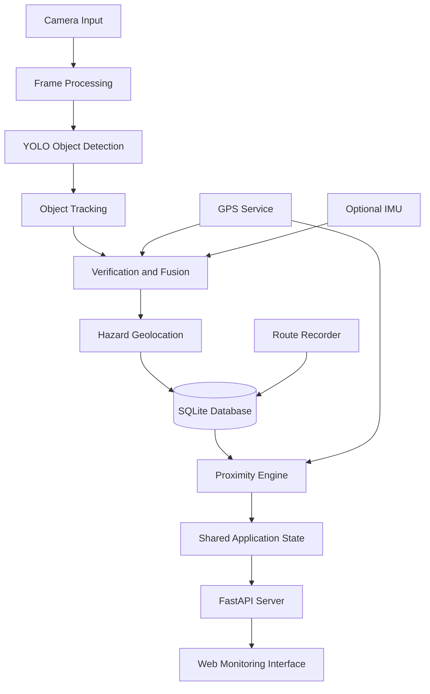

# SmartRoad

**An Offline Road Hazard Detection, Mapping and Route Memory System**

SmartRoad is a camera-based road monitoring and hazard detection system designed for Raspberry Pi 4 and Raspberry Pi 5. It uses computer vision, GPS positioning and a local database to identify road hazards, record their locations and provide warnings when previously detected hazards are encountered again.

The system is designed to operate locally without requiring a continuous internet connection or cloud-based processing.

## Overview

SmartRoad combines a forward-facing camera, an object detection model and GPS data to identify and geolocate road hazards such as potholes.

Detected hazards are stored in a local SQLite database. Each record can contain location, detection count, timestamp, estimated severity and supporting images.

When the vehicle travels along a previously recorded route, SmartRoad compares its current position and direction with stored hazards to identify nearby hazards and generate proximity warnings.

The objective is to provide a persistent road hazard awareness system that improves with repeated journeys.

## Key Features

- **Real-time Detection:** Identifies potholes using a lightweight YOLO-based ONNX or TFLite model.
- **GPS-Based Geolocation:** Associates detected hazards with geographic coordinates.
- **Hazard Database:** Stores detected hazards, timestamps, images and detection history in SQLite.
- **Duplicate Detection:** Merges repeated observations of the same hazard within a configurable radius.
- **Route Recording:** Records vehicle movement and identifies previously travelled routes.
- **Proximity Warnings:** Warns the driver when a previously recorded hazard is approaching.
- **Severity Estimation:** Estimates hazard severity using detection confidence, bounding-box area, repeat observations and optional IMU data.
- **Live Monitoring Interface:** Displays camera feed, detection results, GPS information, route history and hazard locations.
- **Offline Operation:** Supports local detection, storage and map functionality without continuous internet access.
- **Privacy Processing:** Provides optional face and vehicle registration plate blurring before images are stored.

## System Architecture

SmartRoad is divided into independent modules responsible for camera capture, detection, GPS processing, verification, database operations and user interface delivery.



### Processing Pipeline

1. The camera continuously captures road frames.
2. Frames are resized and passed to the detection model.
3. Detected objects are processed by the tracking module.
4. Stable detections are passed to the verification engine.
5. GPS position and vehicle direction are used to estimate the hazard location.
6. The database checks whether the hazard already exists.
7. New hazards are recorded, while matching hazards have their detection history updated.
8. The proximity engine checks stored hazards against the vehicle's current position.
9. Relevant warnings and information are displayed through the monitoring interface.

## Hardware Requirements

| Component | Requirement |
|---|---|
| Main Controller | Raspberry Pi 4 or Raspberry Pi 5 |
| Camera | Raspberry Pi CSI Camera or USB Webcam |
| GPS Module | USB or UART NMEA GPS Receiver |
| Display | HDMI or DSI Touchscreen |
| Power Supply | Regulated 5V automotive power supply |
| Optional Sensor | MPU6050 IMU |

A 64-bit Raspberry Pi OS installation is recommended.

Refer to [Hardware Documentation](docs/HARDWARE.md) for wiring and configuration details.

## Software Stack

| Category | Technology |
|---|---|
| Programming Language | Python |
| Object Detection | YOLO, ONNX Runtime, TFLite |
| Computer Vision | OpenCV |
| Camera Interface | Picamera2, OpenCV |
| GPS Processing | NMEA Serial |
| Backend | FastAPI |
| Database | SQLite |
| Frontend | HTML, CSS, JavaScript |
| Mapping | Leaflet, OpenStreetMap |
| Real-Time Communication | WebSocket, MJPEG |
| Testing | Pytest |

## Project Structure

```text
smartroad/
│
├── api/                  # REST API and WebSocket server
├── app/                  # Application entry point and runtime
├── camera/               # Camera interfaces and input sources
├── data/                 # Database, demo data and map tiles
├── database/             # SQLite models and migrations
├── detection/            # Detection, tracking and post-processing
├── docs/                 # Hardware and troubleshooting guides
├── frontend/              # Web-based monitoring interface
├── gps/                  # GPS service and simulator
├── mapping/               # Geolocation, routes and proximity
├── models/                # AI model files and model catalogue
├── privacy/               # Face and registration plate blurring
├── scripts/               # Installation and utility scripts
├── sensors/               # Optional sensor integrations
├── system/                # System health monitoring
├── tests/                 # Automated test suite
├── verification/          # Detection verification and fusion
│
├── config.yaml
├── requirements.txt
├── requirements-pi.txt
├── requirements-windows.txt
├── install_pi.sh
├── install_windows.bat
├── run_windows.bat
├── setup_pi.sh
├── start_smartroad.sh
├── stop_smartroad.sh
├── status_smartroad.sh
└── smartroad.service
```

## Installation

### Windows

The Windows installer prepares the Python environment, installs dependencies, initializes the database and downloads the default detection model.

1. Download or clone the repository.
2. Open the project directory.
3. Run `install_windows.bat`.
4. Launch SmartRoad using the generated desktop shortcut.

For manual execution:

```cmd
run_windows.bat
```

### Raspberry Pi

SmartRoad supports Raspberry Pi 4 and Raspberry Pi 5 running 64-bit Raspberry Pi OS.

Clone the repository:

```bash
git clone https://github.com/pratikdagar100/smartroad.git
cd smartroad
```

Make the installer executable:

```bash
chmod +x install_pi.sh
```

Run the installer:

```bash
./install_pi.sh
```

For unattended installation:

```bash
./install_pi.sh --yes
```

After installation, reboot:

```bash
sudo reboot
```

The installer prepares dependencies, initializes the database, configures the system service and sets up the kiosk interface.

## Operating Modes

SmartRoad provides four input modes.

| Mode | Camera Source | GPS Source |
|---|---|---|
| LIVE | Physical camera | Physical GPS |
| TEST | Physical camera | Simulated GPS |
| VIDEO | Video or image file | Simulated GPS |
| DEMO | Synthetic camera feed | Simulated GPS |

The input source can be changed through the application settings.

### Windows Quick Start

Run a complete simulated demonstration:

```cmd
run_windows.bat --demo
```

Run with a webcam and simulated GPS:

```cmd
run_windows.bat
```

Run using a video file:

```cmd
run_windows.bat --camera video --source road.mp4
```

Run using a specific webcam:

```cmd
run_windows.bat --camera webcam --device 1
```

Run using a USB GPS receiver:

```cmd
run_windows.bat --gps serial --gps-device COM3
```

Run the automated tests:

```cmd
.venv\Scripts\python -m pytest tests
```

Run the hardware diagnostic:

```bash
python -m app.hardware_test
```

## AI Detection Model

SmartRoad uses a lightweight YOLO-based pothole detection model.

The default model is downloaded during installation and stored at:

```text
models/pothole.onnx
```

The installer verifies the downloaded model using its SHA-256 checksum and a test inference.

Model configuration is managed through:

```text
models/catalog.json
```

A different compatible ONNX or TFLite model can be installed through the application settings or manually using:

```bash
python scripts/install_model.py
```

The default model is intended as a baseline. Detection performance can vary depending on road conditions, lighting, camera angle and pothole characteristics.

## GPS and Geolocation

SmartRoad supports USB and UART-based GPS receivers that provide NMEA data.

Typical configurations:

| Platform | GPS Device |
|---|---|
| Windows | COM3 |
| Raspberry Pi USB | /dev/ttyUSB0 |
| Raspberry Pi UART | /dev/serial0 |

The default baud rate is 9600.

GPS coordinates, vehicle heading and estimated forward distance are used to calculate the approximate location of detected hazards.

The system includes a geolocation module that supports different distance estimation approaches. A more accurate distance sensor or depth estimation system can be integrated through the distance estimator interface.

## Hazard Verification and Database

SmartRoad uses SQLite for local data persistence.

Database location:

```text
data/smartroad.db
```

The database maintains information about:

- Vehicles
- Recorded routes
- Road hazards
- Detection events
- GPS tracks
- Application settings

Repeated observations of the same hazard are merged based on a configurable geographic radius.

The default merge radius is 4 metres.

Hazard status values include:

- ACTIVE
- FIXED
- UNKNOWN

The database uses versioned migrations to support schema initialization and updates.

## Route Memory and Proximity Detection

One of the primary functions of SmartRoad is remembering previously detected road hazards.

During a journey, the system records vehicle movement and stores detected hazards geographically.

During subsequent journeys, the proximity engine compares the current vehicle position, heading and stored hazard locations.

If a known hazard is approaching, the interface displays a warning with its estimated distance.

The proximity engine uses geographic distance calculations, directional checks and hysteresis to reduce repeated or unstable warnings.

## Severity Estimation

SmartRoad estimates hazard severity using available detection information.

Inputs can include:

- Bounding-box area
- Detection confidence
- Repeated observations
- Estimated distance
- Optional IMU impact measurements

Severity is categorized as:

- LOW
- MEDIUM
- HIGH

These values are estimates, not direct physical measurements of pothole depth or dimensions.

Bounding-box size alone cannot reliably determine the actual depth of a road hazard.

## Web Interface and API

SmartRoad provides a browser-based dashboard through FastAPI.

The interface includes:

- Live camera feed
- Detection status and confidence
- GPS information
- Interactive road map
- Hazard markers
- Recorded routes
- System health information
- Application settings

Default API address:

```text
http://127.0.0.1:8000
```

### API Endpoints

| Method | Endpoint | Purpose |
|---|---|---|
| GET | `/api/status` | Application status |
| GET | `/api/gps` | GPS information |
| GET | `/api/hazards` | Stored hazards |
| GET | `/api/hazards/nearby` | Nearby hazards |
| GET | `/api/route` | Current route |
| GET | `/api/routes` | Recorded routes |
| GET | `/api/settings` | Application settings |
| GET | `/api/statistics` | Detection statistics |
| GET | `/api/health` | System health |
| POST | `/api/hazards` | Create hazard |
| POST | `/api/hazards/{id}/status` | Update hazard status |
| POST | `/api/settings` | Update settings |
| WS | `/ws/live` | Live application updates |
| GET | `/video.mjpg` | MJPEG camera stream |

The API is bound to localhost by default. LAN access can be enabled using the `app.allow_lan` configuration option.

API write operations can be protected using the `SMARTROAD_API_TOKEN` environment variable.

## Offline Map Support

SmartRoad uses Leaflet for map visualization and OpenStreetMap-compatible tiles.

Online map tiles are used when internet access is available.

For offline operation, map tiles can be stored locally under:

```text
data/tiles/{z}/{x}/{y}.png
```

An NCR overview tile pack can be prepared using:

```bash
python scripts/download_tiles.py --preset ncr
```

Street-level offline maps require an appropriate licensed or self-hosted tile source.

SmartRoad does not include a pre-populated database of Delhi NCR pothole locations. Hazard markers are generated from actual system detections or imported datasets.

External hazard datasets can be imported using:

```bash
python scripts/import_hazards.py potholes.csv --source "PWD-2026"
```

CSV and GeoJSON point data are supported.

## Privacy and Data Handling

SmartRoad is designed around local processing and storage.

- Detection and database operations run locally.
- Captured hazard images are stored locally.
- Images are not automatically uploaded to external servers.
- Optional face and vehicle registration plate blurring is available.
- API access can be restricted using an authentication token.

The optional privacy module uses OpenCV-based processing. Its detection accuracy depends on image quality and the underlying detection method.

## Performance Considerations

For Raspberry Pi deployments, performance can be adjusted through configuration.

Recommended starting points:

| Parameter | Suggested Value |
|---|---|
| Model Input Size | 320 |
| Camera Processing Width | 480 |
| Frame Skip | 2–3 |
| Stream FPS | 10 |
| Model | YOLO Nano or equivalent |

Performance depends on the selected model, camera resolution, processing settings and Raspberry Pi hardware.

An active cooler is recommended for Raspberry Pi 5 deployments under sustained processing loads.

## Current Limitations

- Pothole detection accuracy depends on the training dataset and environmental conditions.
- GPS accuracy affects hazard positioning.
- Forward distance estimation is approximate without dedicated depth hardware.
- Severity classification is an estimate rather than a physical measurement.
- Offline street-level map coverage depends on available tile data.
- Real-world Raspberry Pi hardware configurations require device-level validation.
- Cloud synchronization and multi-vehicle coordination are not currently implemented.

## Future Development

Planned areas of development include:

- LiDAR or depth-camera integration for improved distance estimation.
- IMU-based road impact analysis.
- Raspberry Pi AI Camera and Hailo acceleration support.
- Improved pothole detection models trained on diverse road conditions.
- Voice-based hazard warnings.
- Multi-vehicle hazard sharing and fleet monitoring.
- Cloud synchronization with conflict handling.
- Remote model updates.

## Testing and Verification

The project includes an automated Pytest suite covering core application functionality.

Test coverage includes:

- Database operations
- Detection and tracking
- Geolocation
- Hazard proximity
- Route processing
- API functionality
- Application logic

The project documentation reports 62 passing automated tests and an end-to-end simulated demonstration.

Physical hardware functionality, including camera interfaces, UART GPS, system services and kiosk startup, should be verified on the target Raspberry Pi.

## Documentation

Additional technical documentation:

- [Hardware Setup](docs/HARDWARE.md)
- [Troubleshooting](docs/TROUBLESHOOTING.md)
- [AI Model Documentation](models/README.md)

## Repository

Source code and updates:

https://github.com/pratikdagar100/smartroad

## License

Add the appropriate open-source license before distributing or reusing this project. Until a license is added, the repository remains subject to the default copyright rules.
