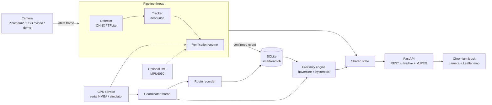
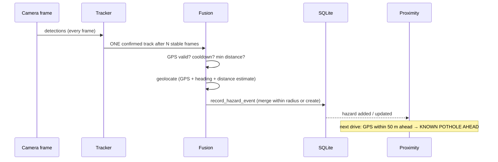

# SmartRoad

**AI dashcam-based road-hazard detection, mapping and route memory** for Raspberry Pi 4/5.

A forward-facing camera watches the road, a lightweight YOLO model finds potholes, GPS places each one on a map, and
everything is stored in a local SQLite database. When you drive the same road again, SmartRoad warns
**"KNOWN POTHOLE AHEAD – 35 m"** — fully offline.

```
+-----------------------------------------------------------------+
| ◆ SMARTROAD   GPS● CAMERA● AI● DB●        DRIVE HEALTH SETTINGS  31 km/h |
+----------------------------------+------------------------------+
| LIVE CAMERA                      | LIVE MAP (Leaflet / OSM)     |
|  ⚠ KNOWN POTHOLE AHEAD   35 m    |   ▲ vehicle   ● hazards      |
|  ⚠ POTHOLE DETECTED      92 %    |   ━ route     [+][-][NCR]... |
+----------------------------------+------------------------------+
| DETECT 18 fps | GPS ±1.5 m | KNOWN HAZARDS 7 | ROUTE #1 | STORAGE |
+-----------------------------------------------------------------+
```

## One-click install
| Platform | Command | What it does |
|---|---|---|
| **Windows** | double-click `install_windows.bat` | installs Python (via winget if missing), venv, all dependencies, database, demo data, **AI pothole model**, Desktop shortcut |
| **Raspberry Pi** | `./setup_pi.sh` (= `./install_pi.sh --yes`) | apt packages, venv, dependencies, **AI pothole model**, database, systemd service, kiosk autostart, self-test |

After that: Windows → Desktop shortcut **SmartRoad**; Pi → `sudo reboot`.

## Switching live camera / test / video / demo (in the app)
The drop-down in the top bar (and **Settings → Input source**) switches at runtime — the app restarts its camera and GPS
in a few seconds and remembers the choice (`data/ui_source.json`):

| Mode | Camera | GPS |
|---|---|---|
| **LIVE** | real camera (Pi camera / USB) | real GPS (serial) |
| **TEST** | real camera | simulated GPS |
| **VIDEO** | video/image file | simulated GPS |
| **DEMO** | synthetic dashcam | simulated GPS + scripted detector |

Camera index, GPS port and video path are editable there too. Command-line flags still win on a cold start.

## AI model
`install_windows.bat` / `install_pi.sh` download and verify the default model (YOLOv8n pothole, 13 MB, SHA-256 checked,
verified with a dummy inference) into `models/pothole.onnx`. If it is ever missing the camera panel shows
**AI MODEL NOT INSTALLED** with an **INSTALL** button; **Settings → AI model** lists installed files, installs from
`models/catalog.json` and switches models without a restart. Manual: `python scripts/install_model.py`.
This community model is a small baseline — expect misses on small/dark potholes; fine-tune on your own roads (see models/README.md).

## Quick start

| Goal | Command |
|---|---|
| Full simulated demo (no hardware) | `run_windows.bat --demo` |
| Windows test with webcam + simulated GPS | `run_windows.bat` |
| Windows test with a video file | `run_windows.bat --camera video --source C:\road.mp4` |
| Raspberry Pi install | `./install_pi.sh` then `sudo reboot` |
| Tests | `.venv\Scripts\python -m pytest tests` |
| Hardware self-test | `python -m app.hardware_test` |

## Architecture





### Threads (UI never blocked)
camera capture · GPS · DB writer (bounded queue) · pipeline (resize, frame-skip, inference, events, JPEG) ·
coordinator (route, proximity, health) · health sampler · API (uvicorn). Each worker is supervised: a crash is logged,
reported in the UI and restarted with back-off. Camera, GPS, AI and DB failures degrade only their own panel.

### Layout
```
app/            main.py, config.py, runtime.py (wiring), state.py, hardware_test.py
camera/         base_camera, opencv_camera, picamera2_camera, demo_camera, factory
detection/      detector (ONNX/TFLite/demo), postprocess (YOLOv5/v8/NMS decode), tracker
gps/            gps_service (NMEA serial), gps_simulator
mapping/        geo (haversine…), geolocate, proximity (+hazard_proximity alias), route
database/       db, models, migrations (schema v1)
verification/   fusion (event engine), severity
sensors/        imu (optional MPU6050)      privacy/  blur (optional)
api/server.py   REST + WebSocket + static UI
frontend/       index.html, css/, js/, vendor/leaflet (bundled – no CDN)
data/           demo_route.json, demo_hazards.json, hazards/ (images), tiles/ (offline map)
scripts/        make_demo_data, import_hazards, download_tiles, smartroad-kiosk.sh, set_config.py
tests/          pytest suite (62 tests)
```

## Features
- Live camera with boxes, class, confidence, FPS, detection status; **tracker debouncing** (20 frames → 1 event).
- Event gating: `min_confidence`, `min_stable_frames`, `min_distance_between_events`, `cooldown_seconds`, valid GPS.
- **Geolocation of the pothole ahead** (not the car): GPS + heading + distance estimate (`fixed` forward offset by default,
  `bbox` flat-road model optional; `DistanceEstimator` is the plug-in point for LiDAR/stereo).
- Duplicate merging (`hazards.merge_radius_m`, default 4 m) → `detection_count`++, `last_detected` updated.
- **Route memory + proximity engine** with warning/critical distance, "ahead" cone, hysteresis, per-hazard one-shot triggers.
- Route recording (distance + time thresholds), repeat-route detection, polyline on the map.
- **Estimated** severity (LOW/MEDIUM/HIGH) from bbox area, confidence, repeats, range, optional IMU impact —
  *bounding-box size is not depth* and is always labelled "estimated".
- Hazard images (box, confidence, timestamp, GPS, ID) saved only for NEW hazards; optional face/plate blur.
- Health page (CPU, RAM, temperature, disk, camera, GPS, AI, DB, network, IMU), settings page, rotating logs.
- Honest hardware mode: no GPS → "GPS UNAVAILABLE / SIGNAL LOST", no camera → "CAMERA ERROR", no model →
  "AI MODEL NOT INSTALLED". **Nothing is simulated unless `--demo` or `gps.mode: simulated` is requested explicitly**,
  and the UI shows a DEMO MODE / SIMULATED GPS badge.

## Hardware
Raspberry Pi 4 or 5 (64-bit Raspberry Pi OS Bookworm recommended) · Pi camera (CSI) **or** USB webcam · USB or UART NMEA GPS ·
HDMI/DSI touchscreen (800×480, 1024×600, 1280×720 … the UI adapts) · 5 V automotive supply · optional MPU6050.
Wiring: [docs/HARDWARE.md](docs/HARDWARE.md).

## Windows testing
`run_windows.bat` creates `.venv`, installs `requirements-windows.txt` only when it changed, generates demo data if missing,
initialises the database, opens the UI in your browser. Flags are passed straight to `python -m app.main`:

```
run_windows.bat --demo                 # synthetic road, simulated GPS, simulated detector, out-and-back route
run_windows.bat --demo --speed 3       # 3x faster
run_windows.bat                        # webcam (index 0) + simulated GPS
run_windows.bat --camera video --source road.mp4 --model models\pothole.onnx
run_windows.bat --camera webcam --device 1
run_windows.bat --gps serial --gps-device COM3     # real USB GPS
```
Demo mode uses a separate, auto-reset database (`data/smartroad_demo.db`) so your real data stays clean.

## Demo mode walk-through
1. Simulated vehicle drives a ~1.7 km Delhi route (`data/demo_route.json`), out and back, forever.
2. Synthetic dashcam feed shows potholes (`data/demo_hazards.json`) approaching in perspective.
3. Simulated detector → tracker → event engine → **new hazard saved + image + map marker (orange NEW)**.
4. Two potholes are pre-seeded as *known* (red) — the warning appears on the first pass.
5. On the return leg every pothole is met again: **KNOWN POTHOLE AHEAD · 35 m**, then CRITICAL; the new detection *merges*
   into the stored hazard (`detection_count` rises) instead of creating a duplicate.

## Raspberry Pi installation
```bash
git clone <your repo> smartroad && cd smartroad     # or copy the folder
chmod +x install_pi.sh && ./install_pi.sh           # asks before every system-wide change; --yes accepts all
sudo reboot
```
The installer: checks Pi model / 64-bit / Python ≥ 3.9; installs only *missing* apt packages (no upgrade; numpy, opencv,
picamera2 come from apt and are reused through a `--system-site-packages` venv so pip never breaks them); installs
`requirements-pi.txt`; creates folders; initialises SQLite; offers group membership (video, dialout, i2c), GPS device
detection, UART/I2C enabling; installs `smartroad.service` (systemd, `Restart=always`) and the Chromium kiosk autostart
(systemd-less desktop entry + labwc/wayfire hooks); finishes with `python -m app.hardware_test`. Re-running is safe.

Helper scripts: `start_smartroad.sh`, `stop_smartroad.sh`, `status_smartroad.sh`.
Make sure the desktop auto-logs in (`raspi-config → System → Boot → Desktop Autologin`) so the kiosk can open.

## Camera setup
`camera.backend: auto` → Picamera2 on a Pi with a CSI camera, otherwise OpenCV. Force with `picamera2`, `opencv`
(`camera.device: 0` or `/dev/video0`), `video` / `image` (`camera.source`). Capture is 1280×720, but frames are
downscaled to `camera.process_width` (640) before AI. Mount the camera level with the horizon about 40 % down the image.

## GPS setup
USB GPS: `gps.device: /dev/ttyUSB0` (or `/dev/ttyACM0`). UART GPS: wire to the header (see HARDWARE.md), enable the
hardware serial port, use `/dev/serial0`. Baud usually 9600. Windows: `COM3`. Needs a clear sky view; first fix 1–5 min.
Only NMEA GGA/RMC/VTG/GSA is parsed, by `gps/gps_service.py`; nothing else touches the port.

## Model setup
Copy a trained YOLO ONNX/TFLite model to `models/pothole.onnx`; set `model.classes` in model order. See
[models/README.md](models/README.md). Without a model the app runs and shows **AI MODEL NOT INSTALLED**.

## Delhi NCR map & real pothole data
* The map opens on a **Delhi NCR overview** (button **NCR** returns to it) and jumps to the vehicle at the first fix.
* Online OpenStreetMap tiles are used when internet exists; an **offline tile pack** in `data/tiles/{z}/{x}/{y}.png` is the
  base layer when offline (overview zoom 8–11 is bundled-by-script: `python scripts/download_tiles.py --preset ncr`).
  Street-level offline tiles for all of NCR must come from a source that permits bulk download (self-hosted
  OpenMapTiles/Protomaps or a licensed provider) — `tile.openstreetmap.org` forbids bulk downloading, so the script caps itself.
* **SmartRoad ships with no pothole locations of its own.** Markers are *your* detections plus anything you import:
  `python scripts/import_hazards.py potholes.csv --source "PWD-2026"` (CSV with latitude, longitude, optional
  type/severity/confidence/date/status, or GeoJSON points). No public, geolocated Delhi-NCR pothole dataset was found; official
  complaints (PWD Sewa, MCD) can be exported or requested and imported with that script.

## Database
`data/smartroad.db` (SQLite, WAL). Tables: `vehicles, routes, hazards, detections, gps_tracks, settings`
(schema in `database/migrations.py`, versioned with `PRAGMA user_version`). Hazard statuses: ACTIVE / FIXED / UNKNOWN.

## API (127.0.0.1:8000)
`GET /api/status · /api/gps · /api/hazards · /api/hazards/nearby · /api/route · /api/routes · /api/settings ·
/api/statistics · /api/health` · `POST /api/hazards · /api/hazards/{id}/status · /api/settings` ·
`WS /ws/live` · `GET /video.mjpg`. Bound to localhost; `app.allow_lan: true` opens it to the LAN. Set the environment
variable `SMARTROAD_API_TOKEN` to require `Authorization: Bearer <token>` on all POSTs. Cloud sync is intentionally not
implemented yet (config stub `cloud:`; credentials would come from environment variables).

## Performance tips (Pi)
`model.input_size: 320`, `model.frame_skip: 2–3`, `camera.process_width: 480`, `camera.stream_fps: 10`, use a YOLO-nano/small
model, INT8 TFLite or a Hailo/AI-camera later. Watch **HEALTH** for CPU/temperature; use an active cooler on the Pi 5.

## Privacy
`privacy.enabled: true` blurs faces and plates (OpenCV Haar cascades — coarse; swap in a better detector in
`privacy/blur.py`) before an image is written. Images are never uploaded automatically.

## Future improvements
Depth/LiDAR range via `DistanceEstimator`; IMU-driven severity; Hailo / Pi AI camera backend; cloud sync with
conflict handling; multi-vehicle fleet map; heading-up map rotation; voice alerts; OTA model updates.

## Troubleshooting
See [docs/TROUBLESHOOTING.md](docs/TROUBLESHOOTING.md).

## Self-review checklist (verified)
Imports and paths · Windows batch idempotent · bash scripts syntax-checked (`bash -n`) · DB created on first run and
migrated idempotently · camera/GPS/map/model-absent handled without crashes · duplicate merge · repeat-route match ·
62 automated tests passing · demo run end-to-end (6 physical potholes → 6 hazards over multiple laps).
**Not verifiable here:** real Pi hardware (Picamera2, UART GPS, systemd, kiosk boot) — run `./install_pi.sh` and
`python -m app.hardware_test` on the device.
# smartroad

